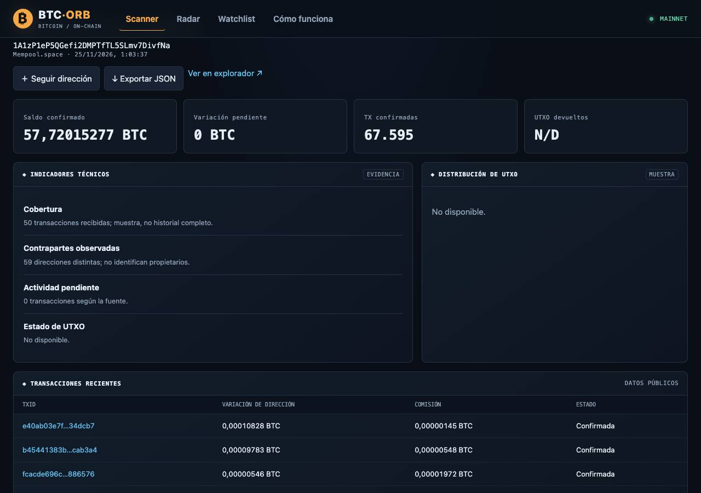
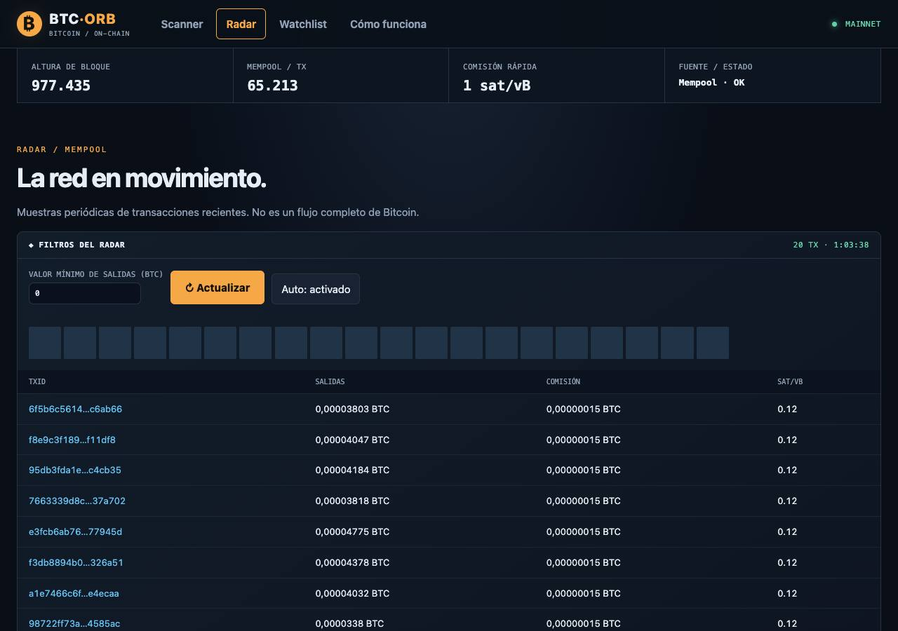

# BTC·ORB — Bitcoin Intelligence

Explorador independiente de Bitcoin mainnet, en español, con estética de terminal y visualizaciones animadas.

## Capturas reales

Capturas de BTC·ORB v0.2 ejecutado en un navegador del iMac, con API de Bitcoin operativa. El esquema inicial está etiquetado como ilustrativo.

### Scanner

### Informe de dirección

### Radar de mempool

## Funciones
- Scanner de direcciones públicas y TXID: saldo, transacciones recientes, UTXO y comisiones.
- Mapa animado de contrapartes observadas, con detalles de cada nodo.
- Registro progresivo de consultas y estados parciales.
- Radar de mempool: muestras cada 30 segundos con la página visible, filtro de valor de salidas, hasta 120 TX de la sesión.
- Watchlist e historial local, exportación JSON y metodología.

## Ejecutar
Abre `index.html` en un navegador moderno, o sirve el repositorio con `python3 -m http.server 8502` y visita http://localhost:8502.

## GitHub Pages
En Settings → Pages → Build and deployment, selecciona Deploy from a branch, main, / (root), Save. La URL prevista es https://frangonzas.github.io/BTC-ORB/.

## Datos y privacidad
Utiliza la API pública de https://mempool.space/docs/api/rest. No requiere credenciales ni conexión de wallet. El proveedor recibe la consulta y puede limitar el acceso. Los datos no disponibles se señalan; el esquema animado inicial se etiqueta como ilustrativo. Las conexiones en una transacción no prueban control común; una transferencia no equivale a una venta. Sin puntuaciones de fraude ni asesoramiento financiero. El radar es una muestra, no un flujo completo. La watchlist no envía alertas en segundo plano. ChatGPT y Robin no están integrados todavía.

## Diseño
Implementación propia inspirada en los paneles de inteligencia blockchain, sin reutilizar código, imágenes ni marca de QuantumOrb. HTML, CSS y JavaScript sin dependencias.

## Versión
0.2 — interfaz animada, radar, scanner, UTXO e historial.
